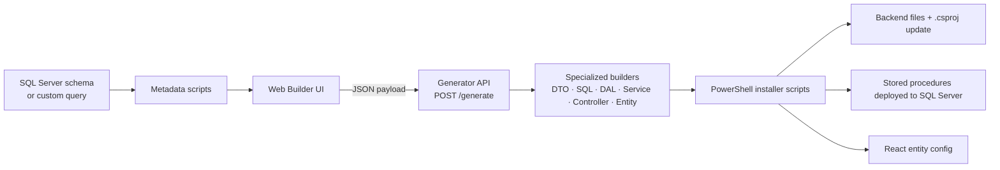
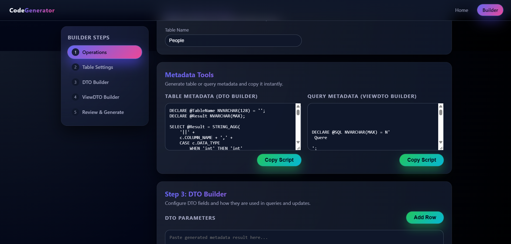
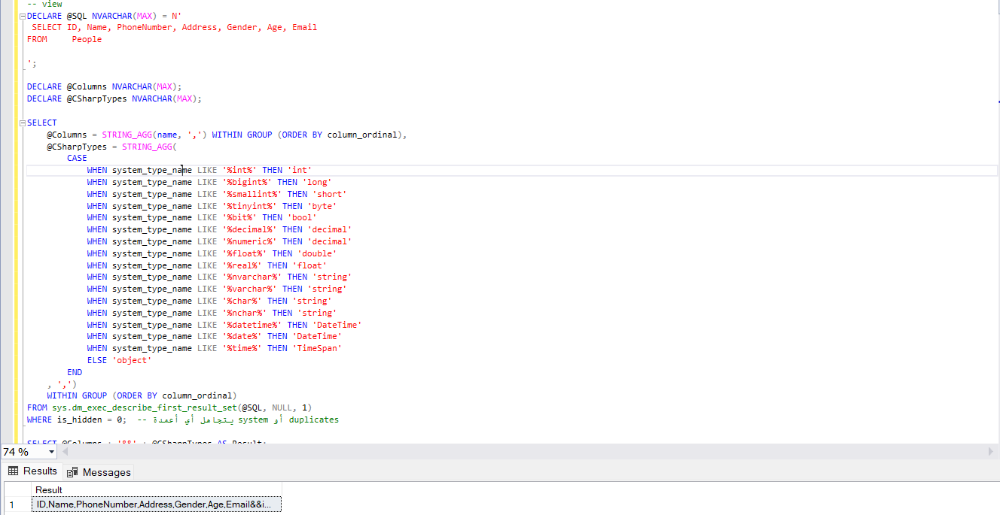
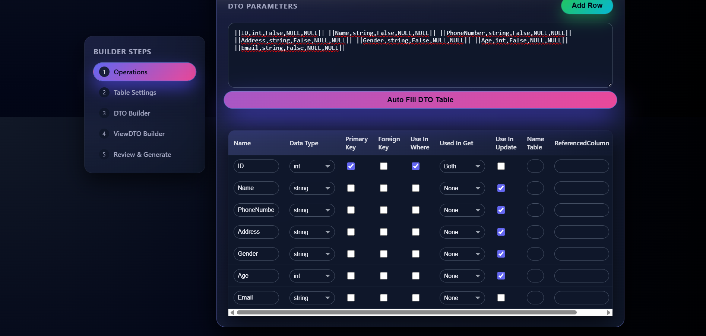
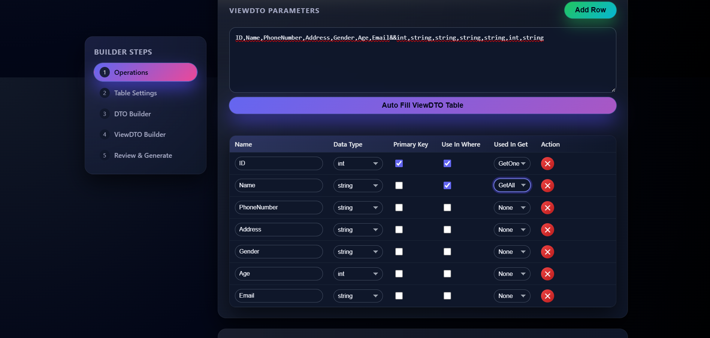
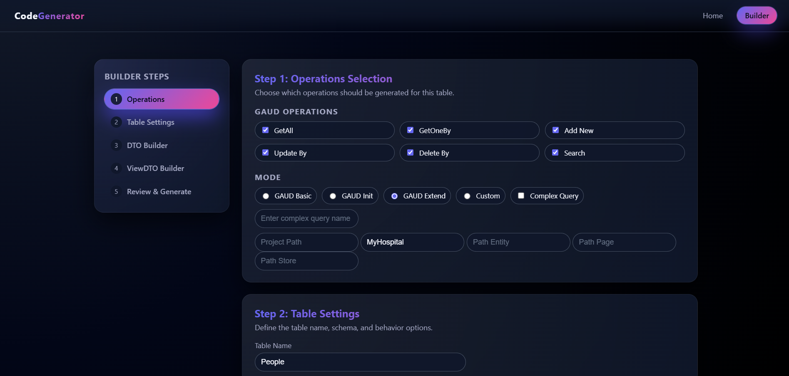
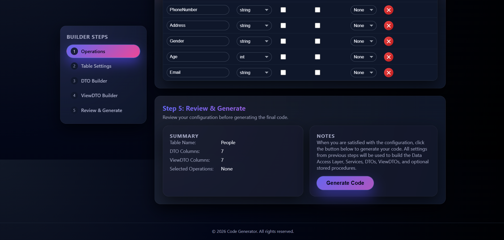
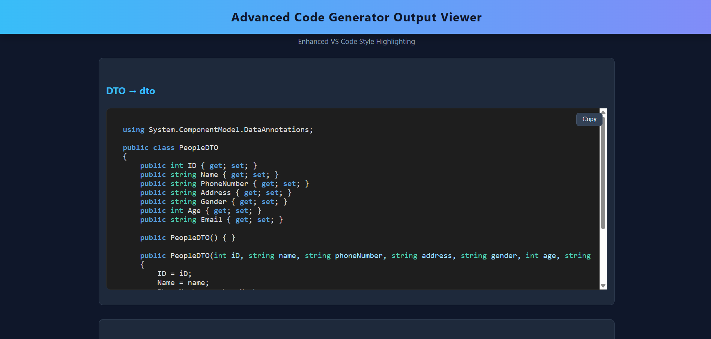

<<<<<<< HEAD
# ⚙️ Schema-Driven Backend Code Generation Platform

> Turn a SQL Server table (or any custom query) into a complete, layered **ASP.NET Core CRUD backend**
> plus **stored procedures** and a **React entity config** in a few clicks, cutting repetitive setup from **days to hours**.

<p align="center">
  
</p>

> 🔒 **The engine's source code is private.** This repository showcases its architecture, workflow and the quality of the code it generates.
> Interested in a custom backend built with it, or a live walkthrough? See [Contact](#-contact).

---

## 📌 Table of contents
- [The problem](#-the-problem)
- [What it generates](#-what-it-generates)
- [Architecture](#-architecture)
- [Workflow (step by step)](#-workflow-step-by-step)
- [Generation modes](#-generation-modes)
- [Example: `People` table](#-example-people-table)
- [Standardized error handling](#-standardized-error-handling)
- [Real-world usage](#-real-world-usage)
- [Current scope](#-current-scope)
- [Tech stack](#-tech-stack)
- [Contact](#-contact)

---

## 🎯 The problem
Every database-driven backend repeats the same work for every table: DTOs, data access, services, controllers, stored procedures, error handling and front-end configuration. It is slow, repetitive and easy to get subtly wrong.

## 💡 The solution
A metadata-driven platform made of a **web builder UI** and a **generator API**.
You describe a table once (columns, keys, which columns are used for lookup / update / search) and it produces every layer consistently, then **installs it into your project for you** (files created, `.csproj` updated, stored procedures deployed).

## 📦 What it generates

| Layer | Output |
|---|---|
| **DTO** | Request/response model with FK validation attributes |
| **ViewDTO** | Read model (supports custom / joined queries) |
| **UpdateDTO** | Partial-update model (nullable fields) |
| **Search model** | Query-string filter object |
| **Data Access Layer** | Async ADO.NET, stored-procedure calls, `CancellationToken` support |
| **Service layer** | Business-layer wrapper with not-found handling |
| **REST Controller** | `GetAll`, `GetOneBy…`, `Add`, `UpdateBy…`, `DeleteBy…`, `Search` with `ProducesResponseType` metadata |
| **Stored Procedures** | Get-all, get-one, add, update, delete, search, each with `@Message` / `@ErrorType` outputs |
| **Front-end entity** | React entity config (columns, filters, form fields, FK dropdown sources) + empty Page/Store files |
| **Project plumbing** | `ApiResult<T>`, `ErrorType`, `ApiResponseHelper`, connection class (once per project) |

## 🏗️ Architecture



**Design ideas**
- **Builder pattern:** each artifact has its own builder, all fed from one shared payload.
- **Metadata-driven:** no hardcoded entities; column roles (PK, FK, lookup, update, search) come from configuration.
- **Delivery as scripts:** the output is a PowerShell script that installs everything, idempotent and safe to re-run (it never overwrites existing files).

## 🧭 Workflow (step by step)

### 1) Extract metadata from SQL Server
Two helper scripts are provided in the UI. Enter a table name and get a compact metadata string (column, C# type, FK info). For view models, paste any `SELECT` (joins included) and get its columns and types.

<p align="center"></p>

Running the metadata script in SSMS returns the whole table description as one compact string, ready to paste:

<p align="center"></p>

### 2) Paste the metadata → auto-fill the DTO table
Roles are then adjusted per column: Primary Key, Foreign Key, *Use in Where*, *Used in Get*, *Use in Update*.

<p align="center"></p>

### 3) Configure the ViewDTO
Same idea for read models: choose which columns drive *GetOne* and *GetAll/Search*.

<p align="center"></p>

### 4) Choose operations, mode and target paths
<p align="center"></p>

### 5) Review & Generate
<p align="center"></p>

### 6) Copy the generated script and run it in PowerShell
The output viewer shows every generated artifact with one-click copy. Run the final script and everything is installed.

<p align="center"></p>

## 🎛️ Generation modes

| Mode | Purpose |
|---|---|
| **GAUD Init** | Run **once per project**: folder structure, `ApiResult<T>`, `ErrorType`, response helper, connection class, **plus** the first table's full stack |
| **GAUD Extend** | Run for **every new table**: the complete stack, with no project plumbing repeated |
| **GAUD Basic / Custom** | Pick individual operations (GetAll, GetOneBy, Add, UpdateBy, DeleteBy, Search) |
| **Complex Query** | Supply a custom/joined query for the read side (ViewDTO, GetAll, GetOne, Search) |

## 🔬 Example: `People` table

**Input:** a table with `ID, Name, PhoneNumber, Address, Gender, Age, Email`, with `Name` as the search filter and `ID` as the lookup key.

**Output (one run):**

```text
Models/
 ├─ DTO/PeopleDTO.cs
 ├─ ViewDTO/PeopleViewDTO.cs
 ├─ UpdateDTO/PeopleUpdateDTO.cs
 └─ Search/PeopleSearch.cs
DataAccessLayer/PeopleData.cs
Services/People.cs
Controllers/PeopleController.cs
SQL Server → SP_GetAllPeople, SP_GetPeopleByID, SP_AddPeople,
             SP_UpdatePeopleByID, SP_DeletePeopleByID, SP_SearchPeople
Frontend  → entities/PeopleEntity.js (+ empty PeoplePage.jsx / PeopleStore.js)
```

All files below were produced by the engine in one run (paths sanitized): see [`/examples/people`](examples/people).

Generated REST surface for this single table:

| Method | Route | Purpose |
|---|---|---|
| GET | `api/peoples/all` | List all |
| GET | `api/peoples/{id}` | Get one |
| GET | `api/peoples/SearchPeople?Name=` | Prefix search |
| POST | `api/peoples` | Create (returns `201` + location) |
| PUT | `api/peoples/{id}` | Partial update |
| DELETE | `api/peoples/{id}` | Delete |

## 🛡️ Standardized error handling
Every generated stored procedure returns `@Message` and `@ErrorType`. The DAL maps the code to an `ErrorType` enum, and one shared helper turns it into the right HTTP status and a uniform response body:

| ErrorType | HTTP |
|---|---|
| None | 200 / 201 |
| InvalidId | 400 |
| NotFound | 404 |
| AlreadyExists, LogicalDependency | 409 |
| DatabaseError | 500 |

FK-violation on delete is detected in T-SQL and returned as a readable "linked to other records" message instead of a raw SQL error.

## 📊 Real-world usage
- **Hospital Management System:** 24 controllers / 127 endpoints, CRUD scaffolded by the engine
- **Aluminum Production ERP:** 20 entity configurations scaffolded
- **Accounting & Inventory System:** CRUD layer generated, effort focused on reporting and bulk processing

## 📐 Current scope
- Designed for SQL Server with ADO.NET and stored procedures
- Assumes a single integer identity primary key per generated table
- Output targets ASP.NET Core Web API + React entity configs

## 🧰 Tech stack
C# · ASP.NET Core Web API · SQL Server / T-SQL · ADO.NET · PowerShell · JavaScript (builder UI)

## 📬 Contact
Open to freelance work: custom ASP.NET Core backends built with this engine.
Rafeiq Refay

=======
# Code_Generation
>>>>>>> 67a4af67ab1cd5b0925af0b12f85c3cd9796c313
